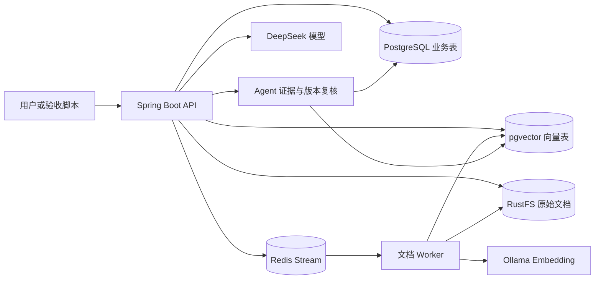
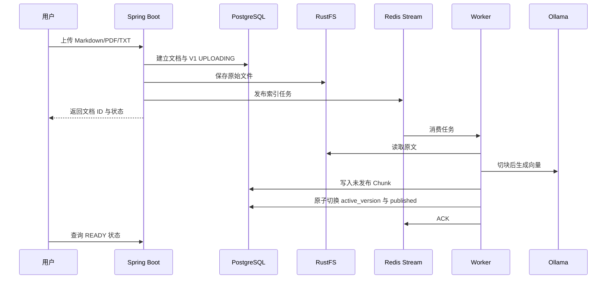
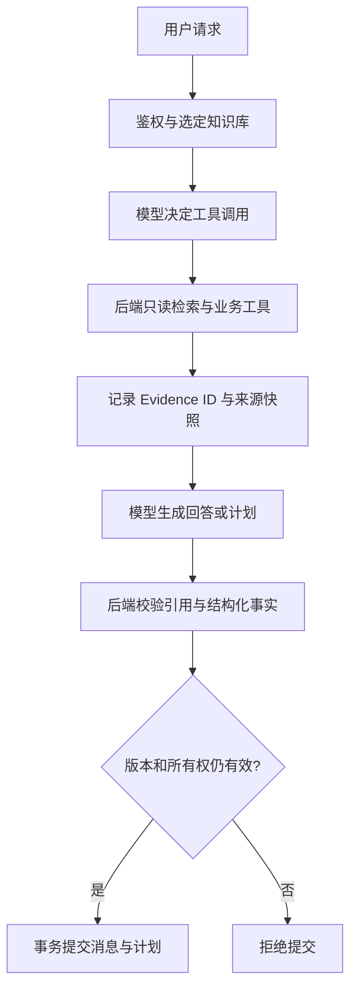

# 系统架构与证据流程

## 整体架构

Spring Boot 负责鉴权、面试业务、Agent 执行和文档生命周期。用户所有权、文档版本、已发布状态和引用核对在后端完成。Ollama 负责 Embedding；DeepSeek 负责聊天、面试分析和学习计划生成。

## RAG 文档生命周期

失败版本不会自动成为活跃引用。Worker 对未确认任务执行重试和数据库状态对账。替换文件时仍可读旧版，直到新版成功发布；删除时先撤销发布，再清理向量与对象。

## Agent 执行和证据校验

已保存的薄弱点原因和个人评价总述来自后端核对的面试事实；开放式建议仍是模型文本。精确会话记忆当前覆盖每日学习时间与面试公司，只查本会话原始用户消息。其他自然语言没有同等级确定性保证，详见 [稳定化报告](../testing/v8-stabilization-report-2026-10-20.md)。
