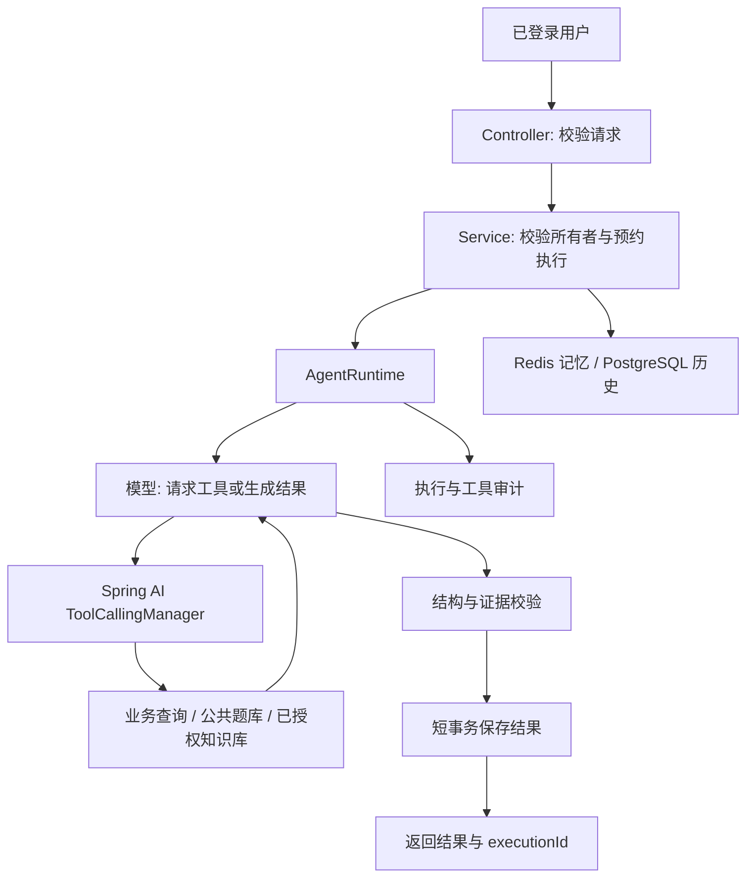
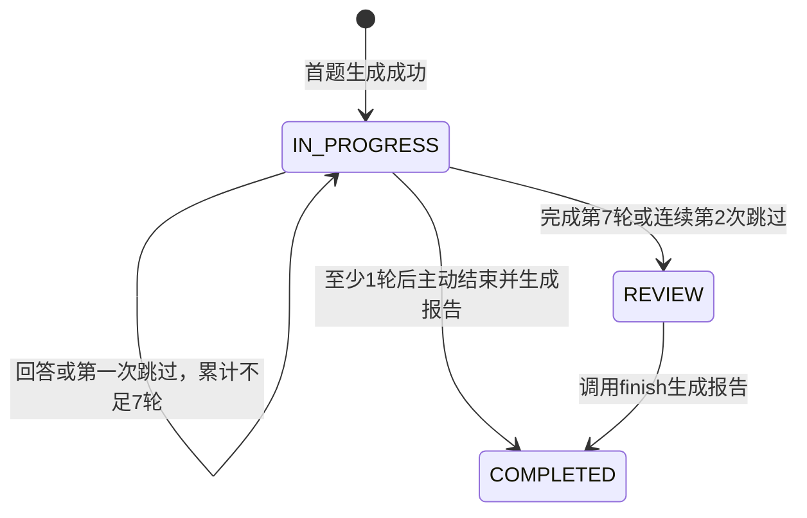

# V8 Agent 平台实施与使用文档

本文对应 2026-10-14 的 V8 实施。项目使用 Java 21、Spring Boot 3.5.5、Spring AI 1.1.8、PostgreSQL/pgvector、Redis、Ollama 和 DeepSeek。业务数据已在 PostgreSQL 中，不再使用 MySQL。

## 1. 本次完成的能力

| 阶段 | 实际实现 |
| --- | --- |
| V8.1 Tool Calling | 5 个只读工具：历史面试、薄弱点证据、学习档案、题库关键词查询、知识检索 |
| V8.2 面试 Agent | 工具辅助追问与换题，逐轮分析落库，7 轮上限，连续 2 次跳过进入复习 |
| V8.3 学习规划 | 查询真实个人数据，生成并保存结构化 7 天计划，检查时间预算及引用 ID |
| V8.4 Memory | 按用户与会话隔离的 Redis 记忆；缓存失效后从 PostgreSQL 恢复 |
| V8.5 Prompt | 4 种 Prompt 的版本管理、管理员激活、文件回退、执行版本记录 |
| V8.6 工程约束 | 工具白名单、调用预算、超时、结构校验、执行轨迹、管理员权限和并发保护 |

模拟面试、通用辅导和学习规划共享一个有预算限制的执行器。工具只读取业务数据，不能让模型直接修改面试状态、删除文档或管理用户。

### 对原方案的调整

- V6 已有模型追问决策与结构化输出，V8 在此基础上增加真实工具、证据和可验证的业务状态。
- 工具集中在一个小型 `AgentTools` Bean 中，没有为每个简单查询建立一组重复的层。
- 学习计划由 Agent 生成，服务端验证并保存，没有建立会再次递归调用模型的 `StudyPlanTool`。
- 错题来自已完成的逐轮评价，不再复制一套重复的错题数据。
- 会话历史与工具审计分开保存。审计是调用轨迹，不是模型内部推理过程。
- 采用自定义 Redis/PostgreSQL 会话存储，向 Spring AI 提供规范的 Message 列表。仅添加 Redis 依赖并不会自动开启聊天记忆。

## 2. 模块与调用流程

主要新增模块位于 `src/main/java/com/shtbs/interview/agent/`：

| 文件 | 职责 |
| --- | --- |
| AgentModels | 请求、学习档案、薄弱点、每日计划与结构化响应 |
| AgentTools | 对模型开放的只读工具 |
| AgentRepository | 用户限定的数据查询、消息、计划与审计持久化 |
| AgentRuntime | Spring AI 工具循环、预算、超时及输出转换 |
| AgentService | 会话归属、证据验证、计划保存及查询 |
| AgentMemory | Redis 缓存、历史恢复与上下文窗口 |
| PromptService | Prompt 版本创建、激活和回退 |
| InterviewPolicy | 7 轮和连续跳过的确定性规则 |

`InterviewServiceImpl` 负责面试的事务与状态控制；`AgentController` 提供辅导和规划接口；`PromptController` 提供管理员 Prompt 接口；`RequireAdmin/AdminInterceptor` 保护公共资源写操作。



模型返回的工具请求由 Spring AI 的 `ToolCallingManager` 处理。执行器关闭模型内部自动工具循环，自行检查次数与期限，避免隐藏的无限调用。

结构或业务证据校验失败时，执行器最多允许一次修正，消耗同一个执行的模型调用和时间预算。修正后仍不合法则返回 6003，不保存消息或计划。诊断日志只记录失败的字段或规则，不打印模型全文和凭据。

关闭 BeanOutputConverter 默认的原文错误日志，由执行器记录字段级诊断，避免解析失败时把模型全文写入服务器日志。

## 3. 面试规则与并发控制

### 回合定义

- 一次成功提交的回答计为一轮。
- 一次显式跳过也计为一轮。
- 空字符串不是跳过：客户端必须提交 `skip=true`。
- 参数错误、模型失败、超时和被拒绝的并发请求不增加轮数。
- 正常回答会将连续跳过次数清零。



进入 `REVIEW` 后不再向客户端发送或保存下一题；用户可以查看逐轮结果，并调用 finish 完成最终报告。学习规划的历史工具只使用 `COMPLETED` 面试，因此进入复习后应先完成报告。

面试期间回答接口只返回下一题、轮数、状态和执行标识，不提前返回评分、缺失知识点或标准答案。复习接口仅在 `REVIEW/COMPLETED` 状态可读。

全部跳过的面试使用确定性的 0 分报告，并明确缺少作答证据，不调用模型猜测具体技术能力。

### 回答提交的三个阶段

1. 短事务锁定会话：校验所有者、状态和预期回合，检查幂等键，预约 3 分钟租约。
2. 事务外调用 Agent：读取已经提交的历史，并分析本次回答。
3. 短事务提交：检查租约、版本和状态，原子保存候选人消息、下一题及逐轮分析，更新会话计数。

模型调用期间不持有数据库连接或行锁。

`requestId` 是客户端的业务幂等键；租约使用独立随机令牌。相同 requestId 和相同内容会返回已完成的缓存结果，相同键对应不同内容会返回冲突。失败的旧请求不能被重新应用到后续回合。

旧客户端可以省略 requestId 和 expectedRound，服务端会生成 requestId；但客户端要获得网络重试的幂等保障，应始终提供并复用这两个字段。

## 4. 工具、权限与证据

V8.8 已将下面的基础引用校验升级为结构化证据、可确定事实和精确知识引用校验。本文旧响应示例保留作版本背景；新生成的薄弱点、题目推荐与知识来源须提供新增证据字段，详见 [V8.8 Grounding 实施文档](v8.8-grounding.md)。旧存储 JSON 仍可读取。

| 工具 | 数据边界与限制 |
| --- | --- |
| getUserProfile | 当前用户的目标、阶段、每日学习分钟数；不含邮箱或密码 |
| getInterviewHistory | 当前用户最近 1～5 场已完成面试及最终评价 |
| analyzeWeaknesses | 最近 5 场完成面试，每场最多 3 条低分、错答或跳过证据，并包含最终报告摘录 |
| searchQuestions | 标题、分类和内容关键词搜索，最多 10 题，不返回标准答案 |
| searchKnowledge | 公共同步知识，加上请求显式指定的最多 5 个私人知识库；最多返回 8 个片段 |

用户身份由后端通过 ToolContext 传入，不是模型可选择的参数。私人知识库先验证所有者，再按 `knowledgeBaseId/userId/published` 过滤；公共知识限定 `ingest_owner=knowledge-sync-v1`。

面试和评价只开放知识与题库检索工具。辅导与规划开放全部 5 个只读工具。未知工具、写操作工具和不符合预算的工具请求会在执行前拒绝。

学习规划必须实际执行档案、历史和薄弱点工具，才能完成输出。服务端额外检查：

- 恰好包含 day 为 1～7 的 7 项计划。
- 每天 minutes 不超过档案中的 dailyMinutes。
- 薄弱点引用的 sessionIds 必须来自本次工具返回的证据，不能为空。
- 推荐的 questionIds 必须来自本次题库工具结果。
- sources 必须来自本次知识工具结果。
- 结构、字符串长度、列表长度和数值范围符合约束。

没有已完成面试时可以生成基于目标的基础计划，但 weaknesses 应为空，message 应说明缺少历史依据。系统不为未测主题编造能力分数。结构与引用校验不能替代对模型文字结论的人工判断。

## 5. API 示例

所有接口继续使用 `Authorization: Bearer <token>`。响应继续包装在 Result 中。

### 学习档案

```http
PUT /agent/profile
Content-Type: application/json
```

```json
{
  "target": "Java后端实习",
  "level": "学生",
  "dailyMinutes": 60
}
```

`GET /agent/profile` 查询档案。未设置时默认目标为 Java 后端、阶段为学生、每天 60 分钟；这些是默认值，不是模型分析结果。dailyMinutes 允许 15～480。

### 辅导与学习规划

```http
POST /agent/chat
POST /agent/study-plans
```

```json
{
  "conversationId": null,
  "message": "根据我最近的面试表现制定一周Java后端提升计划",
  "knowledgeBaseIds": []
}
```

conversationId 为空时创建会话；后续请求使用响应中的同一个 ID。CHAT 与 STUDY 会话类型隔离，不能把一种会话 ID 传给另一种接口。

响应 data 结构：

```json
{
  "conversationId": "服务端生成的UUID",
  "executionId": "服务端生成的UUID",
  "studyPlanId": 123,
  "result": {
    "message": "计划依据与说明",
    "weaknesses": [
      {
        "topic": "HashMap",
        "reason": "面试中遗漏扩容细节",
        "sessionIds": [10]
      }
    ],
    "plan": [
      {
        "day": 1,
        "topic": "HashMap扩容",
        "minutes": 60,
        "tasks": ["阅读resize流程", "练习相关题目"],
        "questionIds": [2]
      }
    ],
    "sources": ["hashmap.txt"]
  }
}
```

以上仅展示字段结构，实际计划包含 7 天；示例 ID 不可直接作为模型证据使用。辅导响应的 studyPlanId 为 null。

### 面试

开始：

```http
POST /interview
```

```json
{
  "category": "Java",
  "difficulty": "EASY",
  "knowledgeBaseIds": []
}
```

回答：

```http
POST /interview/123/answer
```

```json
{
  "requestId": "3d715976-a57d-4d54-9269-94c6a5ca2b71",
  "expectedRound": 1,
  "answer": "HashMap扩容涉及容量、阈值和元素重新分布",
  "skip": false
}
```

跳过：

```json
{
  "requestId": "5c1265c8-ddc2-4d67-8d7e-634b1c9dcb1f",
  "expectedRound": 2,
  "skip": true
}
```

回答响应包含 sessionId、requestId、executionId、completedRounds、status 和 nextQuestion。进入 REVIEW 后 nextQuestion 为 null；如果本次直接命中跳过规则而没有模型调用，executionId 也为 null。

`POST /interview/{sessionId}/finish` 生成最终报告；重复结束返回已有报告，不重复创建评价。

### 查询与清理

| 方法与路径 | 用途 |
| --- | --- |
| GET /interview?page=1&size=20 | 当前用户面试列表 |
| GET /interview/{id}/review | 复习阶段的题目、回答、评分和缺失点 |
| GET /interview/wrong-answers?page=1&size=20 | 已进入复习或完成面试的低分、错答和跳过记录 |
| GET /agent/conversations?page=1&size=20 | 当前用户的 Agent 会话 |
| GET /agent/conversations/{id}/messages?afterId=0 | 按 ID 游标读取最多 100 条已完成消息 |
| DELETE /agent/conversations/{id} | 删除该会话、关联计划、消息与执行审计，并清理缓存 |
| GET /agent/study-plans?page=1&size=20 | 当前用户计划列表 |
| GET /agent/study-plans/{id} | 已保存的结构化计划 |
| GET /agent/executions?page=1&size=20&sessionId=123 | 当前用户执行列表，sessionId 可省略 |
| GET /agent/executions/{id} | 执行状态、Prompt 版本、次数及工具轨迹 |

分页 size 上限为 100。进行中的会话不允许删除。跨用户访问返回不存在或拒绝访问，不返回其他用户数据。

## 6. Prompt 与管理员

Prompt 名称固定为 CHAT、STUDY、INTERVIEW、EVALUATION。数据库保存不可覆盖的版本；同一名称同时最多启用一个版本。激活操作使用事务和 PostgreSQL advisory lock。

| 方法与路径 | 功能 |
| --- | --- |
| GET /admin/prompts | 查看版本 |
| POST /admin/prompts/{name} | 创建版本，body 为 version 与 content |
| PUT /admin/prompts/{name}/active/{version} | 激活或回滚到已有版本 |

如果没有启用版本，回退到 `src/main/resources/prompts/` 下的对应文件，审计 prompt_version 为 0。数据库不可用时不会伪装为正常运行。

角色存储在 app_user.role 中，默认 USER。注册请求不能指定 ADMIN。管理员权限覆盖：

- 用户列表与直接创建账号。
- 公共题库新增、修改、删除。
- 公共知识同步。
- Prompt 版本管理。

普通用户仍可注册、登录、修改自己的账户、读取公共题库、管理自己的知识库、面试和学习计划。

首次管理员由数据库操作者明确选择账号，不自动提升某个历史账号。先登录并通过 `GET /user/me` 确认自己的 ID，再执行：

```powershell
.\tools\Set-V8Admin.ps1 -UserId 你的用户ID
```

此工具默认使用本机 my_pgvector 容器；可用 DatabaseContainer 参数指定其他容器。账号有面试、Agent 或知识库数据时，删除账号会返回冲突，避免遗留业务记录或破坏引用关系。

## 7. Memory、日志与预算

短期记忆按 `agent:memory:{userId}:{conversationId}` 缓存，TTL 为 7 天，每次成功请求刷新。最多保留 10 条消息、每条最多 6000 字符，总计不超过 24000 字符，并保持完整的用户/助手消息对。

PostgreSQL 保存已经完成的用户与助手消息。Redis 丢失、过期或暂时不可用时可从数据库恢复窗口。失败请求不写入会话消息或学习计划。个人目标通过学习档案持久化，不依赖某次会话永不失效。

Agent 执行状态为 INIT、THINKING、TOOL_CALL、GENERATING、VALIDATED、COMMITTING、FINISHED、FAILED、TIMED_OUT。V8.7 起 FINISHED 与业务保存同事务提交，具体预算、严格参数、超时和回收规则见 [V8.7 实施说明](v8.7-agent-runtime.md)。工具状态包含 RUNNING、SUCCEEDED、FAILED、TIMED_OUT、NOT_EXECUTED。

每次执行记录 owner、会话或面试 ID、Prompt 版本、模型次数、工具次数、错误码与时间。工具记录实际 toolCallId、工具名、输入、输出摘要、状态与耗时。输入最多保存 4096 字符，输出最多保存前 8192 字符；审计输出可能是截断的 JSON，不能当成完整业务结果解析。

默认配置：

```yaml
agent:
  max-model-calls: 6
  max-tool-calls: 12
  max-context-chars: 48000
  max-output-tokens: 4096
  timeout-ms: 60000
  call-timeout-ms: 20000
```

上下文限制采用字符预算，不声称是精确输入 token 计量。4096 为每次模型输出 token 上限。总执行期限最长允许配置为 120 秒，低于 3 分钟业务租约。执行线程池为 4 个工作线程、8 个排队位置；满载时返回服务不可用。

超时后取消 Future，并禁止过期结果提交。网络调用可能无法立即响应线程中断，因此同时配置 HTTP 连接与读取超时，不把 Future.cancel 当作远端请求已终止的证明。

## 8. 数据库迁移与本机启动

新增迁移为 `db/postgresql/003_agent_platform.sql`，在原 001、002 完成后执行一次。它新增 8 张表，并给用户增加角色、给面试增加回合和租约信息。历史候选人消息用于初始化回合数，不伪造历史逐轮评价。

原 interview_session、interview_message、interview_evaluation 和 vector_store 数据保留；历史最终报告仍可参与规划。历史没有完整题目消息的空会话不补造内容，应重新开始面试。

本机已经执行 003。迁移前备份位于：

```text
.migration-backups/v8-before-20261014.dump
```

新环境执行迁移的示例：

```powershell
Get-Content .\db\postgresql\003_agent_platform.sql -Raw -Encoding UTF8 |
  docker exec -i my_pgvector psql -U postgres -d java_rag -v ON_ERROR_STOP=1
```

数据库还原会覆盖迁移后的数据，应该在需要恢复时另行核对和执行，不能把备份命令当作自动回退步骤。

构建和启动：

```powershell
mvn -s tools/maven-central-settings.xml -gs tools/maven-central-settings.xml package
.\tools\Start-V8.ps1 -UseIdeaEnvironment
```

Start-V8 默认从 8200 开始选择可用端口，以隐藏进程启动并输出 PID 与 URL，日志保存在 target/v8-端口.out.log 和 err.log。它不会关闭已有服务器。

Windows 下运行中的 Java 进程可能占用同名 JAR。升级打包前先停止你自己启动的 V8 进程，再重新 package 和启动；不要关闭其他项目进程。

本机 AI_API_KEY 和 QQ_MAIL_AUTH_CODE 原先位于 IntelliJ 的运行配置中。UseIdeaEnvironment 只在启动子进程时读取这些值，不把凭据写入源码或文档；也可以通过环境变量或已经忽略的 .local-secrets.yml 提供。PostgreSQL 与 RustFS 的本地凭据继续由原 .local-secrets.yml 加载。

依赖仍是 PostgreSQL 5432、Redis 6379、Ollama 11434、RustFS 9000。向量维度由 knowledge.embedding.dimension 配置，默认 768，文档处理记录与 VectorStore 使用同一个配置。

## 9. 一并修复的现有问题

| 问题 | 修复 |
| --- | --- |
| 回答失败留下候选人消息 | 成功分析后原子保存消息与逐轮结果 |
| 并发重复回答、结束后写下一题 | 预约租约、会话版本、幂等键、提交时状态检查 |
| 单轮分析丢失、非法评分 | 保存逐轮评价并校验结构与 0～100 范围 |
| 普通用户修改公共资源 | ADMIN 角色与接口级权限检查 |
| DTO 注解没有触发 | 补 Valid、内容长度和显式跳过校验 |
| 分页无上限或不稳定 | 页码、size 限制与 ID 排序 |
| SMTP 属性层级错误 | 移到 spring.mail.properties，启用 SSL 与超时 |
| 余弦相似度公式错误 | 除以两个向量模长的乘积 |
| 文档旧任务误删新任务向量 | 每次处理令牌进入向量 ID 与 metadata，按 attempt 清理和发布 |
| 上传失败覆盖删除状态 | 状态条件保护，只有实际更新成功才更新父文档 |
| UPLOADING 中断无法恢复 | 对账超时上传：检查对象，恢复入队或明确标记失败 |
| 废弃片段遗留 | 定期清理失败、未发布及已经失去文档记录的生命周期片段 |

文档原有活动版本保持策略继续有效：新版成功前旧版可检索，新版失败不撤销旧版。私人检索只读取 published=true 的片段。

## 10. 验证与复现

测试文件：

- InterviewPolicyTest：7 轮、连续跳过、跳过重置、DTO 校验和余弦公式。
- V8PostgresTest：真实 PostgreSQL 随机隔离 schema；验证工具调用、计划保存、引用校验、权限、记忆恢复、幂等、失败重试、并发、超时和文档处理令牌。
- V8LiveSmokeTest：显式开启后使用当前服务器、真实 DeepSeek 与 Redis，创建并清理临时合成账号和记录。

默认 mvn test 不会主动调用收费模型。数据库和真实模型测试分别通过环境变量开启：

```powershell
$env:V8_TEST_JDBC_URL = 'jdbc:postgresql://localhost:5432/java_rag'
mvn -s tools/maven-central-settings.xml -gs tools/maven-central-settings.xml test
```

测试密码从 V8_TEST_JDBC_PASSWORD 或项目本地 POSTGRES_PASSWORD 读取，不输出到日志。隔离 schema 名称具有 v8_test_ 随机前缀，测试结束只清理该 schema。

真实接口测试需要服务器已启动：

```powershell
$env:V8_LIVE_SMOKE_URL = 'http://localhost:8200'
mvn -s tools/maven-central-settings.xml -gs tools/maven-central-settings.xml test -Dtest=V8LiveSmokeTest
```

真实模型测试只发送临时合成账号的档案与面试样本，以及可公开读取的题库/知识资料，不读取其他用户的私人面试或知识库。临时业务记录和登录态在 finally 中清理；ID 序列可能前移，这是 PostgreSQL 的正常行为。

首次实际请求发现外部启动进程没有读取 IntelliJ 的 AI_API_KEY，表现为上游 401 和本系统 HTTP 502/6001。改为从原运行配置注入环境变量后，真实工具调用、连续会话记忆、7 天计划保存、权限拒绝及两次跳过进入复习均已通过。

完整回归结果：34 项通过、0 失败、0 错误、0 跳过，包括 7 项规则与输入测试、26 项隔离 PostgreSQL 测试和 1 项真实接口流程测试。真实模型实测验证过来源引用被拒绝后的一次修正流程。

最后的修正提示与日志配置调整后，又完成 3 项针对性复测：JSON 修正、非法引用修正和完整真实接口流程，均通过。实际服务监听 PID 与启动脚本返回的 PID 一致；最终检查没有遗留隔离测试 schema 或临时账号。

最终构建已通过，服务地址为 `http://localhost:8200`。启动脚本已实际验证，两个 PowerShell 脚本均通过语法检查。

迁移与测试清理后的原有行数保持为：app_user=5、question=2、interview_session=6、interview_message=5、interview_evaluation=1、vector_store=7。隔离测试 schema 和临时 v8p_ 账号已清理。历史账号未被自动提升为管理员。

## 11. 当前边界

- 这是后端交付，没有新增前端或 Swagger 页面。服务 URL 用于 API 调用。
- /ai/chat 仍保留 V5 的单次辅导接口；带会话和工具的完整能力使用 /agent/chat。
- 不提供邮件发送、文件删除或账号管理的模型工具。
- 学习计划目前生成、保存、查询；任务完成进度和日历提醒不在本次范围内。
- 没有声称日志能展示模型隐藏推理，也没有声称引用校验能证明所有自然语言结论正确。
- 没有把历史面试补成不存在的单轮分数。
- PostgreSQL 业务约束与工具权限不能由用户 Prompt 或知识片段改写。

Spring AI 1.1 对应参考：[工具调用与 ToolContext](https://docs.spring.io/spring-ai/reference/1.1/api/tools.html)、[聊天记忆](https://docs.spring.io/spring-ai/reference/1.1/api/chat-memory.html)。
